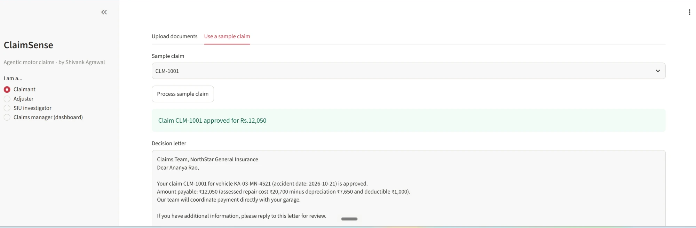

# ClaimSense on AWS — Agentic Motor Insurance Claims Processor

**Author:** Vishal Gupta (AWS capstone edition) · based on [ClaimSense](#credits) by Shivank Agrawal

A multi-step AI agent that processes Indian private-car insurance claims end to end:
it reads the claim PDFs, checks the policy, decides coverage by citing policy clauses,
calculates the payable amount, scores fraud risk, auto-approves small clean claims and
routes everything else to a human adjuster or the Special Investigation Unit (SIU).
This edition runs the agent on **Amazon Bedrock** and deploys to **AWS ECS Fargate** with Terraform
from a Windows laptop in one command.

```
intake -> policy_check -+-> coverage_check -> assess_amount -+-> fraud_check -> route_claim -+-> finalize
 (LLM)     (Python)     |    (BM25 + LLM)       (Python)     |   (LLM+Python)    (Python)    |    (LLM letter)
                        +------- policy failed --------------+                               +-> human_review -> finalize
                                                                                                (pauses for adjuster/SIU)
```

```
Laptop (Windows / PyCharm)                         AWS
deploy.ps1 ── docker build/push ──────────► ECR
           ── Terraform ──────────────────► ECS Fargate task:  api (FastAPI + LangGraph) :8000 ──► Amazon Bedrock
                                                               ui  (Streamlit)          :8501
           ── Bedrock key ────────────────► SSM Parameter Store (SecureString, injected at start-up)
                                            CloudWatch Logs · Security group (your IP only) · AWS Budget alerts
```

## Screenshots

**Claimant portal on AWS (ECS Fargate):** sample claim CLM-1001 processed end to end by the agent on Amazon Bedrock.
It was auto-approved for ₹12,050 (repair ₹20,700 − depreciation ₹7,650 − deductible ₹1,000), with an AI-written decision letter.



## Results (20 labelled claims, `python -m evals.run_evals`)

| Metric | Result |
|---|---|
| Model | `qwen.qwen3-vl-235b-a22b-instruct` on Amazon Bedrock |
| Route accuracy (auto / adjuster / SIU) | **100% (20/20)** |
| Recommendation accuracy (approve / reject) | 95% (19/20) |
| Fraud precision / recall (SIU) | **100% / 100%** |
| Payable amount accuracy | **100% (14/14)** |
| Straight-through (no human) rate | 35% (7/20) |
| Avg cost / latency per claim | ≈ ₹0.27 / 16 s |

The one miss (CLM-1019) recommended REJECT instead of APPROVE but was still routed to SIU for a human decision.

## What I built (AWS capstone edition)

Starting from the original ClaimSense (OpenAI + Terraform), I:

- **Moved the LLM to Amazon Bedrock** through its OpenAI-compatible endpoint. I wrote
  [`scripts/check_bedrock_models.py`](scripts/check_bedrock_models.py) to test candidate models on a real
  claim with known answers, and found that only gpt-oss supports `/v1/responses`, no model reads a PDF sent as a file,
  and no embedding model is exposed. Based on that:
  - rewrote [`app/llm.py`](app/llm.py) on the Chat Completions API with structured outputs and a fallback
    that recovers JSON from chatty models;
  - extract PDF text locally with `pypdf`;
  - replaced embeddings with a local **BM25 clause search** plus a domain synonym list
    ([`app/policy_rag.py`](app/policy_rag.py)), so retrieval is free and needs no extra service;
  - chose the model **by evals** (table above), not by name.
- **Made it deployable from Windows** with PowerShell scripts ([`deploy/`](deploy)): `deploy.ps1`, `pause.ps1`, `destroy.ps1`.
  Along the way I fixed real Windows issues: PowerShell 5.1 corrupting piped ECR passwords, ECR tokens too long for
  Windows Credential Manager, and Git Bash path mangling of SSM parameter names.
- **Added security and cost guard-rails**: access limited to the deployer's IP by default, short-lived `aws login`
  credentials (no stored access keys), the API key in SSM (never in Terraform state or the image), an AWS Budget
  with 50/80/100% alerts, and pause/resume (`desired_count = 0`).
- **Wrote a first-time-user guide**, [AWS_DEPLOY_GUIDE.md](AWS_DEPLOY_GUIDE.md): from creating the AWS account to teardown.

## Tech stack
Amazon Bedrock (Qwen3-VL 235B, OpenAI-compatible API) · LangGraph (state machine, human-in-the-loop, SQLite checkpoints) ·
FastAPI · Streamlit · pypdf · BM25 · SQLite · Docker · Terraform · AWS ECS Fargate, ECR, SSM, CloudWatch, Budgets.

## Quick start (local)
Needs Python 3.12+ (3.13 works) and an Amazon Bedrock API key.

```powershell
py -3.13 -m venv venv; .\venv\Scripts\Activate.ps1
pip install -r requirements.txt
copy .env.example .env          # fill in OPENAI_API_KEY (Bedrock key), OPENAI_BASE_URL, OPENAI_PROJECT_ID

python -m scripts.check_bedrock_models                     # which models work with your key
python -m scripts.generate_data                            # DB + 20 sample claim PDFs (no key needed)
python -m scripts.process_claim CLM-1001 CLM-1014 CLM-1019 # watch the agent work step by step
python -m scripts.review_claim CLM-1014 REJECT 0 "Asha Verma (Adjuster)"
python -m evals.run_evals                                  # accuracy, fraud recall, cost per claim
```

Run the API and portal: `uvicorn app.api:app --port 8000` and `streamlit run ui/portal.py`,
or both with `docker compose up --build` (portal :8501, API :8000/docs).

## Deploy to AWS
Full walkthrough: **[AWS_DEPLOY_GUIDE.md](AWS_DEPLOY_GUIDE.md)**. Short version (Windows, Docker Desktop running):

```powershell
aws login --profile claimsense
powershell -ExecutionPolicy Bypass -File deploy\deploy.ps1                  # prints portal + API URLs
powershell -ExecutionPolicy Bypass -File deploy\pause.ps1 -Action stop      # stop paying for Fargate between demos
powershell -ExecutionPolicy Bypass -File deploy\destroy.ps1                 # delete every resource
```
Cost while running: about US$0.05/hour (1 vCPU, 2 GB Fargate task + public IP), plus about ₹0.27 of Bedrock tokens per claim.

## Project structure
```
app/
  config.py      settings, model name, prices, business thresholds
  schemas.py     Pydantic schemas the LLM must fill (structured outputs)
  llm.py         the only file that calls the LLM (Bedrock, chat completions); tracks tokens and cost
  intake.py      PDF text -> typed JSON (one LLM call per document)
  policy_rag.py  clause-level BM25 retrieval over the policy wording
  judgments.py   coverage decision, cross-document consistency, customer letter
  rules.py       deterministic money + fraud + routing rules (no LLM)
  graph.py       LangGraph state machine with human-in-the-loop
  service.py     process / review functions shared by API, CLI and evals
  db.py          SQLite: policies, garages, claims, audit log
  api.py         FastAPI endpoints
ui/portal.py     Streamlit: claimant, adjuster, SIU, dashboard
scripts/         generate_data, process_claim, review_claim, check_bedrock_models
evals/           run_evals.py (labels in data/eval_labels.csv)
data/            policy_wording.md, sample_claims/CLM-1001..1020
deploy/          deploy.ps1, pause.ps1, destroy.ps1, _common.ps1, deploy.sh, destroy.sh, terraform/
docs/            problem.html, solution.html (original design walkthrough)
```

## Credits
The original ClaimSense design and code (the LangGraph workflow, schemas, business rules, sample data generator,
evals, portal, and the problem/solution docs in `docs/`) are by **Shivank Agrawal** (Future with Shivank), created as
course material. This repository is my AWS capstone extension of that project; see *What I built* above.

All companies, people, garages and documents in this project are fictional and for teaching only.
